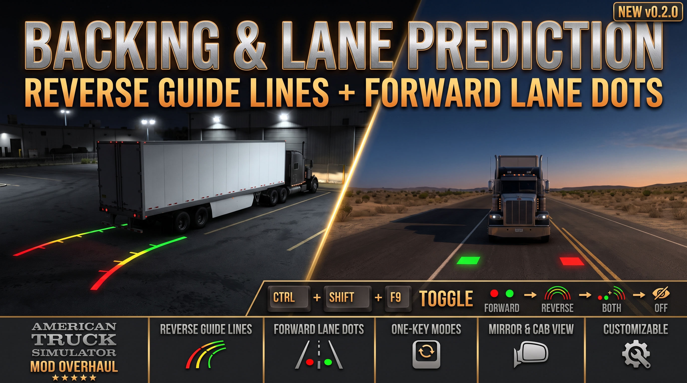
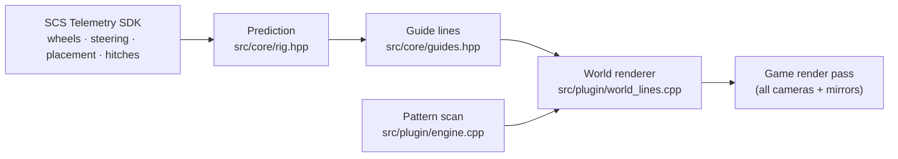

<div align="center">

# Reverse Overlay · Guide Lines for ATS

**Backup-camera style guide lines for reversing in American Truck Simulator,
drawn in the game world and visible in the mirrors.**


[](LICENSE)

</div>

<p align="center"></p>

When you shift into reverse, two lines appear on the ground from the rear
corners of your trailer, or of the truck when you drive without one. They follow
the path the rig will actually take if you hold the current steering:

| | |
|---|---|
| 🟥 **0 – 3 m** | red |
| 🟨 **3 – 8 m** | yellow |
| 🟩 **8 – 15 m** | green, with ticks where each band ends |

## Features

- **In the world, not on the screen:** the lines are real objects, so they show
  up from every camera **and in the mirrors**, where you actually reverse a
  trailer.
- **Real steering geometry:** the path is computed from the game's actual
  front-wheel angles, so it handles different steering locks, lift axles and
  multi-steer trucks.
- **Trailers done properly:** single trailers, doubles and triples, off-axle
  fifth wheels and self-steering trailer axles. Couplings are measured live.
- **Patch-tolerant:** game functions are found by code patterns, not fixed
  addresses. If an update breaks them, the lines switch off cleanly instead of
  crashing the game, and a bundled tool regenerates the patterns.
- **Lightweight:** about 140 small line pieces while reversing, nothing
  otherwise. No network access, and save games are never touched.
- **Configurable:** band distances, path length and line height, all changeable
  while you drive.

## Installation

You need **two parts**. Steam Workshop can't install plugins, so the DLL is a
separate download.

1. **Line models:** subscribe to **Reverse Overlay - Guide Lines - ATS** on the
   Steam Workshop, *or* use the `.scs` included in the download.
2. **Plugin:** download the latest zip from
   [**Releases**](../../releases), exit the game and run `Install.bat`. It
   copies `ats_reverse_overlay.dll` into
   `American Truck Simulator\bin\win_x64\plugins`.
3. Start ATS, accept the *advanced SDK features* notice, enable the mod in the
   Mod Manager, and reverse.

The **[user guide](docs/USER_GUIDE.md)** covers settings, troubleshooting, game
updates and uninstalling.

> [!NOTE]
> The plugin is not code-signed yet. Windows Smart App Control or antivirus
> software may block or flag it. See
> [Windows security](docs/USER_GUIDE.md#7-windows-security-unsigned-plugin).

## How it works



- **Prediction:** a kinematic bicycle model about the tractor's virtual rear
  axle, with curvature from the real wheel angles,
  `k = tan(δ) / (L − x·tan(δ))`. That's exact for Ackermann steering. Each
  trailer obeys a no-side-slip constraint at its equivalent axle, driven by the
  movement of its coupling point. Integration stops at 85° articulation.
- **Guide lines:** the rear-corner paths of the last unit, cut into 0.25 m
  pieces and coloured by distance travelled.
- **Rendering:** plugin-owned model instances submitted from the player
  vehicle's render pass. Five engine functions are located by unique
  wildcarded byte patterns. A function another plugin has already hooked is
  still recognised.
- **Optional top-down panel:** a bird's-eye view drawn with Dear ImGui over
  DirectX 11. It's off by default, and when it's off DirectX isn't hooked at
  all.

## Game updates

After an update, the log shows either *"engine functions located"* (all good)
or *"engine functions missing"* (lines off, game unaffected). In the second
case:

```bash
tools/re/update.sh --apply   # find the functions in the new build, rewrite the patterns
tools/build.sh Release       # rebuild the plugin
```

The finder compares the new executable with a known-good reference using four
independent methods:
- exact patterns;
- loose patterns;
- instruction-shape fingerprints over every function;
- caller voting.

It accepts a result only when they agree. See
[Game updates](docs/USER_GUIDE.md#5-game-updates) for the player side.

## Building from source

Requirements: Windows with **Visual Studio 2026 Build Tools** (MSVC, CMake,
Ninja). The scripts are written for WSL, but the CMake project builds on
Windows directly.

```bash
tools/build.sh Release                  # plugin DLL -> out/
python3 -I tools/make_assets.py all     # mod files: out/mod_stage + workshop/ats/upload
tools/make_release.sh                   # release zip -> out/release/
```

Core tests (platform-neutral, any C++20 compiler):

```bash
c++ -std=c++20 -O2 tests/core_tests.cpp -o core_tests && ./core_tests
```

Workshop publishing steps: [workshop/ats/UPLOAD.md](workshop/ats/UPLOAD.md).

<details>
<summary><b>Repository layout</b></summary>

```
src/core/       platform-neutral prediction, guide lines, panel scene (unit tested)
src/plugin/     SDK plugin, pattern scan, world renderer, optional DX11 panel, settings, log
assets/base/    base line model the coloured variants are generated from
tests/          core unit tests and SVG scene previews
tools/          build, asset, packaging and install scripts
tools/re/       pattern generation and the game-update finder
workshop/ats/   Steam Workshop upload folder, description and checklist
docs/           user guide
third_party/    SCS SDK headers, MinHook, Dear ImGui, licences
```
</details>

## Roadmap

- [ ] Euro Truck Simulator 2 version
- [ ] Code-signed releases
- [ ] Better height on uneven ground (wheel-based ground fit)
- [ ] Configurable colours

## Credits

- In-world drawing technique and base line model:
  [Reverse Posture Assistant For ATS](https://github.com/yyysheng/ATSmods) by
  yyysheng (MIT).
- SCS Telemetry SDK
  · [MinHook](https://github.com/TsudaKageyu/minhook) (BSD-2-Clause)
  · [Dear ImGui](https://github.com/ocornut/imgui) (MIT).

## License

[MIT](LICENSE) © 2026 Robert Bojor. Third-party components keep their own
licences; see [third_party/licenses](third_party/licenses) and
[third_party/imgui/LICENSE.txt](third_party/imgui/LICENSE.txt).

*Not affiliated with or endorsed by SCS Software. American Truck Simulator is a
trademark of SCS Software.*
