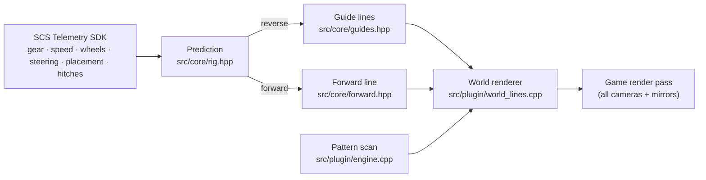

<div align="center">

# Backing & Lane Prediction · ATS

**Backup-camera style guide lines for reversing in American Truck Simulator,
plus a forward line for lane position, drawn in the game world and visible in
the mirrors.**


[](LICENSE)
[](https://steamcommunity.com/sharedfiles/filedetails/?id=3822108979)

</div>

*Formerly **Reverse Overlay - Guide Lines - ATS**. Same Workshop item, same plugin file, new name for 0.2.0.*

<p align="center"></p>

When you shift into reverse, two lines appear on the ground from the rear
corners of your trailer, or of the truck when you drive without one. They follow
the path the rig will actually take if you hold the current steering:

| | |
|---|---|
| 🟥 **0 – 3 m** | red |
| 🟨 **3 – 8 m** | yellow |
| 🟩 **8 – 15 m** | green, with ticks where each band ends |

<p align="center"></p>

In a **forward gear**, a light 🟦 **blue line** runs from the middle of your
front axle along the path the truck will take, curving with the steering. It
is see-through and 25 m long when slow, growing to 40 m at highway speed. At
speed its curve comes from how the truck is actually turning, so it stays true
on long bends. Keep it in the middle of your lane.

## Keyboard shortcut: Ctrl+Shift+F9

One shortcut chooses what you see. Each press moves to the next mode:

| Press | Shows |
|---|---|
| 1st | **Forward line only** |
| 2nd | **Reverse lines only** |
| 3rd | **Both**: the forward line in a forward gear, guide lines in reverse |
| 4th | **Nothing** (everything hidden) |

- The next press starts again with the forward line only.
- The mode is **remembered** between game sessions. The very first start
  is on **Both**.
- The shortcut works only while the game window has focus.
- The log confirms each change, e.g. *"Hotkey: showing forward line only."*
- To use a different key, edit `[hotkey]` in the settings file
  ([details](docs/USER_GUIDE.md#hotkey)).

## What's new in 0.4.0

- **One calm blue line instead of the red and green markers.** It starts under
  the middle of the front axle and follows the path the truck will take, so
  its curve begins where the truck is. It is light blue and see-through.
- **True at highway speed.** Above about 36 km/h (22 mph) the curve comes from
  how fast the truck is actually turning, not from the wheel angle, which
  over-bends at speed because the tyres slip.
- **Update both parts:** the plugin and the Workshop mod (it has the new line
  model). The `[forward]` settings are new; old dot settings are ignored.

0.3.0 stretched the forward dots into lines; 0.2.0 added them and the
four-step Ctrl+Shift+F9 cycle.

Full history: [CHANGELOG.md](CHANGELOG.md).

## Features

- **In the world, not on the screen:** the lines are real objects, so they show
  up from every camera **and in the mirrors**, where you actually reverse a
  trailer.
- **Real steering geometry:** the path is computed from the game's actual
  front-wheel angles, so it handles different steering locks, lift axles and
  multi-steer trucks.
- **Trailers done properly:** single trailers, doubles and triples, off-axle
  fifth wheels and self-steering trailer axles. Couplings are measured live.
- **Patch-tolerant:** game functions are found by code patterns, not fixed
  addresses. If an update breaks them, the lines switch off cleanly instead of
  crashing the game, and a bundled tool regenerates the patterns.
- **Forward line:** the same steering model run forward for the truck,
  switching to the measured turn rate at speed, with smoothing so it stays
  steady.
- **Lightweight:** about 140 small line pieces while reversing and at most 80
  driving forward. No network access, and save games are never touched.
- **Configurable:** band distances, path length, forward line length, width
  and heights, all changeable while you drive.

## Installation

You need **two parts**. Steam Workshop can't install plugins, so the DLL is a
separate download.

1. **Line models:** subscribe to [**Backing & Lane Prediction - ATS**](https://steamcommunity.com/sharedfiles/filedetails/?id=3822108979) on the
   Steam Workshop, *or* use the `.scs` included in the download.
2. **Plugin:** download `Backing_Lane_Prediction_ATS_v0.4.0.zip` from the
   [**latest release**](../../releases/latest), exit the game and run `Install.bat`. It
   copies `ats_reverse_overlay.dll` into
   `American Truck Simulator\bin\win_x64\plugins`.
3. Start ATS, accept the *advanced SDK features* notice, enable the mod in the
   Mod Manager, and drive. Press **Ctrl+Shift+F9** to choose what is shown
   ([see above](#keyboard-shortcut-ctrlshiftf9)).

> [!IMPORTANT]
> **Updating to 0.4.0:** update both parts. The plugin needs the new blue line
> model from the Workshop item (Steam updates it on its own) or the new
> `.scs`. Until then the reverse lines still work, the forward line is
> missing, and the log reports
> *"Could not create /model/rto_guides/line_blue.pmd"*. Your settings file is
> kept; the new `[forward]` settings use their defaults until you add them, or
> delete the file to get a fresh commented copy.

The **[user guide](docs/USER_GUIDE.md)** covers settings, troubleshooting, game
updates and uninstalling.

> [!NOTE]
> The plugin is not code-signed yet. Windows Smart App Control or antivirus
> software may block or flag it. See
> [Windows security](docs/USER_GUIDE.md#7-windows-security-unsigned-plugin).

## How it works



- **Prediction:** a kinematic bicycle model about the tractor's virtual rear
  axle, with curvature from the real wheel angles,
  `k = tan(δ) / (L − x·tan(δ))`. That's exact for Ackermann steering. Each
  trailer obeys a no-side-slip constraint at its equivalent axle, driven by the
  movement of its coupling point. Integration stops at 85° articulation.
- **Guide lines:** the rear-corner paths of the last unit, cut into 0.25 m
  pieces and coloured by distance travelled.
- **Forward line:** the path of the front axle's centre while the truck
  drives `clamp(speed × length_time_s, min, max)` metres, solved as an exact
  arc and stopped after a quarter turn. The curvature comes from the wheel
  angles up to 5 m/s and from the measured yaw rate over speed from 10 m/s,
  blended in between, then smoothed over 0.25 s. The path is cut into 1 m
  pieces laid edge to edge (model instances can't be scaled, and overlaps
  would show darker through the 75 % opacity), in side-by-side 15 cm strips
  for the width. Trailers are ignored.
- **Rendering:** plugin-owned model instances submitted from the player
  vehicle's render pass. Five engine functions are located by unique
  wildcarded byte patterns. A function another plugin has already hooked is
  still recognised.

## Game updates

After an update, the log shows either *"engine functions located"* (all good)
or *"engine functions missing"* (lines off, game unaffected). In the second
case:

```bash
tools/re/update.sh --apply   # find the functions in the new build, rewrite the patterns
tools/build.sh Release       # rebuild the plugin
```

The finder compares the new executable with a known-good reference using four
independent methods:
- exact patterns;
- loose patterns;
- instruction-shape fingerprints over every function;
- caller voting.

It accepts a result only when they agree. See
[Game updates](docs/USER_GUIDE.md#5-game-updates) for the player side.

## Building from source

Requirements: Windows with **Visual Studio 2026 Build Tools** (MSVC, CMake,
Ninja). The scripts are written for WSL, but the CMake project builds on
Windows directly.

```bash
tools/build.sh Release                  # plugin DLL -> out/
python3 -I tools/make_assets.py all     # mod files: out/mod_stage + workshop/ats/upload
tools/make_release.sh                   # release zip -> out/release/
```

Core tests (platform-neutral, any C++20 compiler):

```bash
c++ -std=c++20 -O2 tests/core_tests.cpp -o core_tests && ./core_tests
```

Workshop publishing steps: [workshop/ats/UPLOAD.md](workshop/ats/UPLOAD.md).

<details>
<summary><b>Repository layout</b></summary>

```
src/core/       platform-neutral prediction, guide lines, forward line, hotkey modes (unit tested)
src/plugin/     SDK plugin, pattern scan, world renderer, settings, log
assets/base/    base line model the coloured variants are generated from
tests/          core unit tests
tools/          build, asset, packaging and install scripts
tools/re/       pattern generation and the game-update finder
workshop/ats/   Steam Workshop upload folder, description and checklist
docs/           user guide
third_party/    SCS SDK headers, MinHook, licences
```
</details>

## Roadmap

**Done**

- [x] **0.1.0:** reverse guide lines for the truck and up to ten trailers, red /
  yellow / green by distance, visible in every camera and the mirrors.
- [x] **0.2.0:** forward dots for lane position; Ctrl+Shift+F9 cycles forward
  only / reverse only / both / off; renamed to Backing & Lane Prediction.
- [x] **0.3.0:** the forward dots stretch into lines with speed, and sit far
  enough ahead to clear the hood from the cab.
- [x] **0.4.0:** one calm, see-through blue line from the front axle instead
  of the red and green markers, curved from how the truck is actually turning
  so it stays true at highway speed.

**Next**

- [ ] Code-signed releases
- [ ] Euro Truck Simulator 2 version
- [ ] Better height on uneven ground (wheel-based ground fit)
- [ ] Configurable colours

## Credits

- In-world drawing technique and base line model:
  [Reverse Posture Assistant For ATS](https://github.com/yyysheng/ATSmods) by
  yyysheng (MIT).
- SCS Telemetry SDK
  · [MinHook](https://github.com/TsudaKageyu/minhook) (BSD-2-Clause).

## License

[MIT](LICENSE) © 2026 Robert Bojor. Third-party components keep their own
licences; see [third_party/licenses](third_party/licenses).

*Not affiliated with or endorsed by SCS Software. American Truck Simulator is a
trademark of SCS Software.*
